# Architecture

The platform is a modular monolith: one NestJS API and one NestJS worker over a single PostgreSQL database, which holds the business data, the ledger, the job queue and the audit chain. Three front ends (web, links, Expo tenant app) and WhatsApp sit on top. Rent never passes through the platform: providers settle it directly into landlord and agency accounts (D1). Rules that every session must follow are in `CLAUDE.md`; the reasoning behind each choice is in `docs/decisions/`.

| Topic | Decision | ADR |
| --- | --- | --- |
| Stack | TypeScript; NestJS, Next.js, Expo; PostgreSQL with Drizzle | ADR-001 |
| Tenancy isolation | Row Level Security on every company-scoped table | ADR-002 |
| Ledger | Double-entry books, accrual by rent period, append-only | ADR-003 |
| Money | Integer pesewas, basis points, half-up rounding | ADR-004 |
| Jobs | pg-boss plus a transactional outbox | ADR-005 |
| Documents | HTML templates rendered to PDF, SHA-256, write-once storage | ADR-006 |
| E-signature | Built in-house, one-time-code confirmed | ADR-007 |
| Settlement | Direct to landlord and agency accounts; the platform holds no rent | ADR-008 |
| Hosting | One AWS region chosen by a latency test | ADR-009 |
| Tenant app | Expo for iOS, Android and web; no-login pages in `apps/links` | ADR-010 |
| Authentication | Better Auth | ADR-011 |
| Shared modules | NestJS modules in `packages/server`, used by api and worker | ADR-012 |
| Local storage | SeaweedFS for the S3 API with Object Lock | ADR-013 |
| API contracts | oRPC contracts in `packages/contracts` | ADR-014 |

## 1. System context

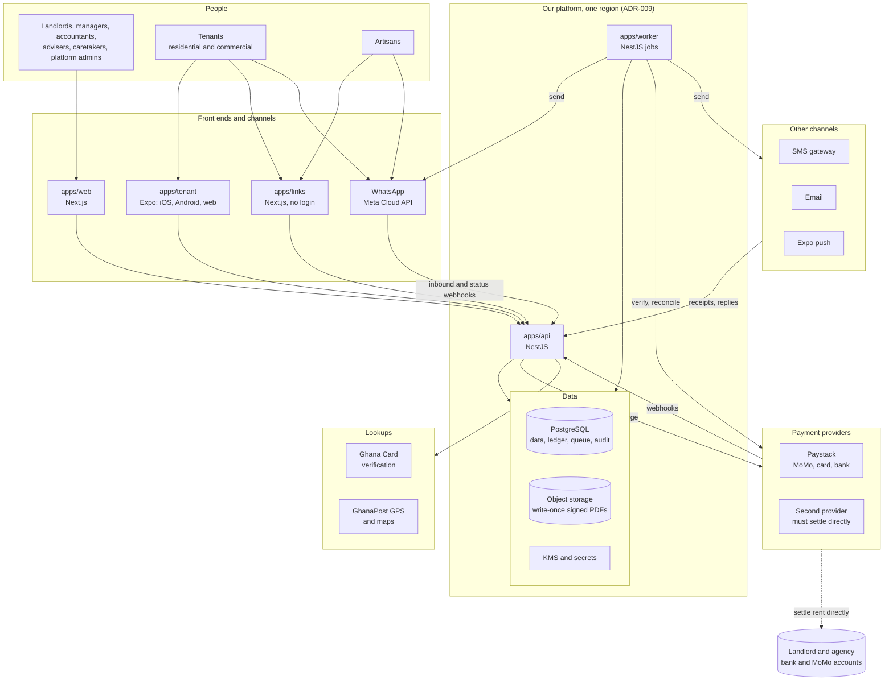

- `apps/api` serves the three front ends and receives every webhook. It never calls a provider inside a database transaction; outbound work goes through the outbox to `apps/worker`.
- `apps/links` hosts every no-login page: pay rent, sign lease, sign notice, renewal offer, artisan job sheet. It is a separate host with no staff cookies.
- The tenant app talks only to the API. Signing always happens on the `apps/links` page, opened in the app's browser, so there is one signing implementation.

## 2. Module map

One NestJS module per PRD module, plus platform modules, arranged in layers. Arrows point down to the layers a module may import, which rules out cycles; anything that must flow upwards travels as a domain event through the outbox.

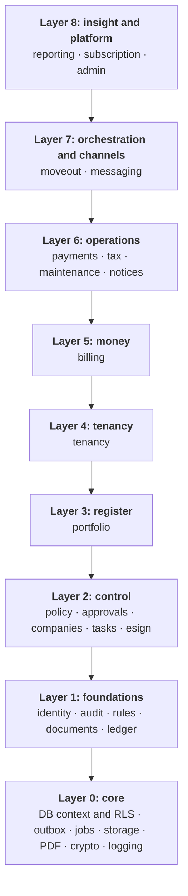

| Module | PRD module | Owns | Imports |
| --- | --- | --- | --- |
| `core` | Platform | DB context and RLS helper, outbox, job runner, storage, PDF service, crypto, logging; NFR security, backup | none |
| `identity` | 14 | Sign-in, sessions, devices, memberships (AD-06; roles of AD-03) | core, audit (sign-in events) |
| `audit` | 14 | Hash-chained audit log, search, verification (AD-07) | core |
| `rules` | 8 | Rules engine and localisation (TX-08; NFR localisation) | core |
| `documents` | Platform | Files, PDF rendering, fingerprints, write-once storage (PR-04 storage) | core, audit, rules (retention) |
| `ledger` | 8 | Books, accounts, journal, posting service, period locks (AC-01) | core, audit (one `ledger.entry_posted` event per entry, M4a) |
| `policy` | 14 | `PolicyService`, role permissions, scopes (AD-03; AD-04 in P2) | identity |
| `approvals` | 14 | Two-person approvals (AD-05) | policy, audit, identity (step-up TOTP) |
| `companies` | 14 | Companies and branding, owners, management agreements, settlement accounts (AD-01, AD-02) | policy, audit, documents, identity (invites), rules |
| `tasks` | 11 | Staff tasks, including notice-ladder caretaker tasks until the field app (CF-06) | policy |
| `esign` | 2, 4 | Signing requests, secure links, one-time codes, evidence, certificate PDFs (TL-07; LN-02, LN-04 signing) | documents, audit |
| `portfolio` | 1 | Portfolios, properties, blocks, units, codes, meters, amenities, import, billing bands (PR-01 to PR-10, PB-01) | companies (owners), documents, rules, audit, policy |
| `tenancy` | 2 | Tenants, ID verification, leases, templates, rent schedule, occupancy, renewals, trackers, advance-cap check (TL-01 to TL-10, TL-12, TL-13, PB-09, TX-05, AR-05 check) | portfolio, esign, approvals, rules, companies, policy, documents, audit, identity (staff to notify) |
| `billing` | 3 | Invoices, allocation, period accrual, prepayments, deposits, cash records and banking, arrears, reminders, paid-until, refunds (BC-01, BC-05, BC-07 to BC-11, BC-13, AR-01 to AR-04, AR-06) | tenancy, ledger, approvals, rules, documents, policy, audit, companies (owner facts, settings), portfolio (a property's owner on a date), identity (collector names, memberships) |
| `payments` | 3 | Providers, pay links, webhooks, verification, matching, unmatched queue, receipts, reconciliation (BC-02 to BC-04, BC-06, BC-12, BC-14) | billing, ledger, companies, documents |
| `tax` | 8 | Rent tax per receipt, due dates, GRA payments, withholding tax (TX-01 to TX-07) | billing, ledger, rules, documents |
| `maintenance` | 6 | Jobs, priorities, assignment, artisan job sheets, inspections (MI-01 to MI-12). M6 stub: `maintenance_job` in its reported state, a ticket number per company and the media attached (CM-04, M6 decision 12) | tenancy, portfolio, documents, policy, audit, companies in M6; from M8 tasks (in-house work), esign (job-sheet tokens and codes), ledger (expenses, P15), identity and rules. M8 adds expenses (AC-03) here |
| `notices` | 4 | Templates, effective dates, issue, tracking, ladder, escalation, service records (LN-01 to LN-10) | tenancy, esign, approvals, rules, documents, tasks, billing |
| `moveout` | 2, 6 | Move-in report signing and move-out: notice, inspection, deductions, final statement, refund (TL-08, TL-11, MI-11) | tenancy, maintenance, billing, approvals, tax (P17 on P11), esign, ledger, documents, tasks, policy, audit, companies, portfolio, identity, rules (M8) |
| `messaging` | 5 | Channels, inbox, menu bot, templates, consent, broadcasts, push (CM-01 to CM-12) | tenancy, esign, companies, identity (staff addresses), audit, policy in M3; billing (the bot's figures), documents, maintenance (repairs, CM-04), portfolio (units and blocks) and rules from M6. Payments registers its pay and receipt links with messaging (M4b), so messaging never imports payments |
| `reporting` | 8, 13 | Fees, expenses, owner statements, remittances, dashboards, Gate 1 metrics (AC-02 to AC-08, DA-01 to DA-06) | ledger, billing, tax, portfolio, tenancy, maintenance, notices |
| `subscription` | 14, section 21 | Plans, rate cards, snapshots, platform invoices, entitlements, dunning (AD-08, PB-01 to PB-11) | tenancy, ledger, payments, companies |
| `admin` | 14 | Platform admin console, support access with consent, usage and messaging costs (AD-10) | subscription, companies, identity, audit |

The lint rule `rent/module-layers` enforces this table (`packages/config/eslint/index.js`, MODULE_MAP; `maintenance` joined it in M6); same-layer imports listed here are allowed because none forms a cycle. Whether a company's plan includes a feature (the inbox, broadcasts, tenant groups, maintenance, the bot's full menu) is asked of `EntitlementsService` in `companies` (M6 decision 9), never by role. Any module queues an outbound message inside its own transaction with `queueMessage` in `core` (an outbox event of type `messaging.send`), so esign and tenancy send messages without importing messaging (M3 plan 4.9). Events that cross layers upwards, for example: `payment.posted` (payments → messaging sends the receipt), `repair.reported` (messaging → maintenance creates the ticket, CM-04), `inspection.completed` (maintenance → moveout), `signing.link_ready` (esign → messaging). Phase 2 modules (utilities, commercial portal, leasing, field app, owner view) slot into layers 6 to 8.

## 3. Data model

### Conventions

- **Keys.** UUIDv7 primary keys, generated by the application (or `uuidv7()` on PostgreSQL 18). Every company-scoped table also has `UNIQUE (company_id, id)`, and foreign keys between company-scoped tables are composite `(company_id, x_id)`, so a row can never point at another company's row.
- **Scoping and RLS.** Every company-scoped table has `company_id NOT NULL`, RLS enabled and forced, and the policy `company_id = current_setting('app.company_id')::uuid`. Global tables without RLS: `country`, `rule`, `ledger_account`, `plan`, `rate_card`, auth identity tables (`person`, sessions), `webhook_inbox` (resolved to a company before processing) and, from M6, `message_template` (our template texts, readable by the application), and `whatsapp_account`, `whatsapp_template_status` and `push_device`, which the application role cannot read at all: it goes through narrow system functions (ADR-002).
- **Money.** `*_minor bigint` plus `currency char(3)`. Rates are `*_bps integer`.
- **Dates.** Instants are `timestamptz` (UTC); business dates are `date` in the company's time zone.
- **Deletes.** Financial and evidence tables are never deleted (append-only, below). Master data (properties, units, tenants, vendors) is archived with `archived_at`, never hard-deleted once referenced. Unissued drafts (leases, notices) may be hard-deleted. An Act 843 deletion request anonymises personal fields in place and keeps financial and notice records for the retention period.
- **Append-only tables.** `journal_entry`, `journal_line`, `allocation`, `payment`, `receipt`, `audit_event`, `unit_status_event`, `notice_event`, `message`, `message_event`, `message_attachment`, `broadcast_recipient`, `maintenance_job_attachment`, `message_template`, `signature`, `document`, `webhook_inbox` (payload; processing results go to `webhook_processing`), `approval_decision`, `consent_event`, `rule`, `period_lock`. The full list is `APPEND_ONLY_TABLES` in `packages/db/src/append-only.ts`, checked by a test. Triggers reject UPDATE and DELETE, and the application role has neither privilege.
- **Immutable once issued.** Invoices, leases after signature and notices after issue keep their content; their status is derived from events, allocations or signatures. Changes create new records (credit note, amendment or renewal lease, correcting notice).

### 3.1 Companies, people and control

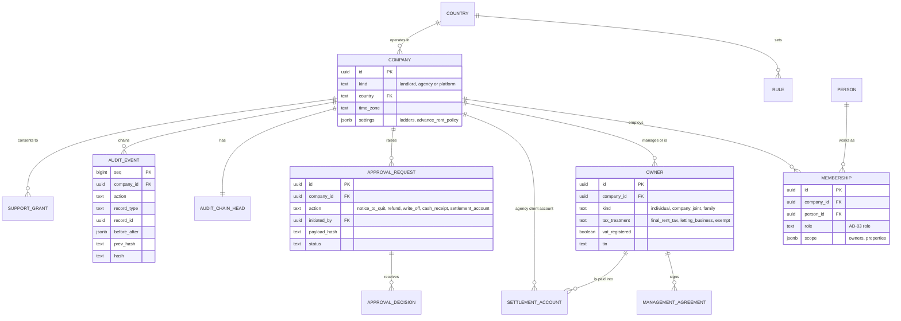

### 3.2 Register

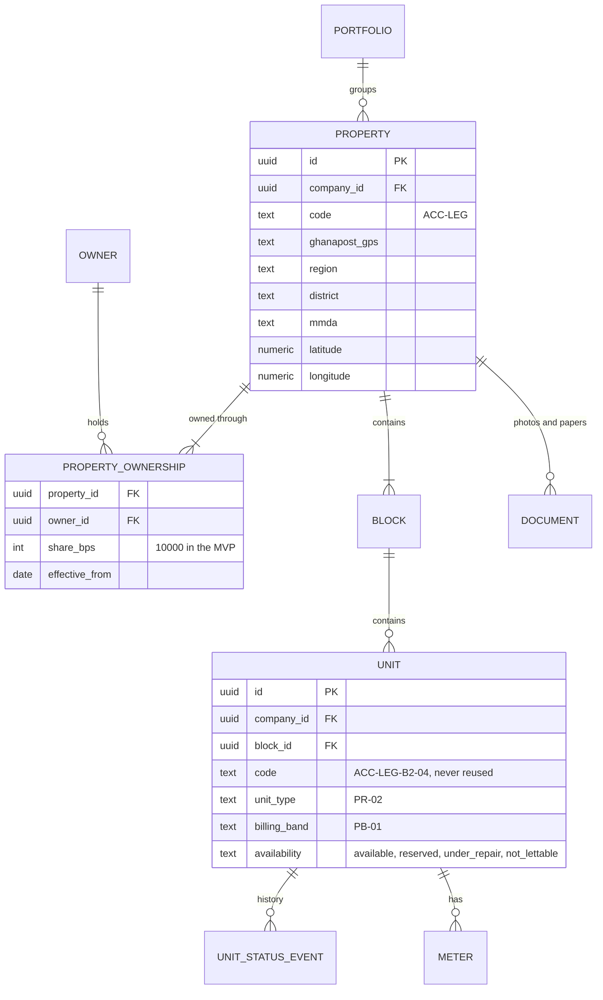

A property without blocks gets one hidden default block, so every unit has a block. `PROPERTY_OWNERSHIP` holds a single 100% row in the MVP; joint ownership (PR-07) adds rows without a migration. Occupancy is not stored on the unit: it is derived from leases (PB-09).

Built in M2 (`docs/plans/M2.md`, section 4):

- **Unit codes.** Four parts, `AREA-PROP-BLOCK-UNIT` (`ACC-LEG-B2-04`). The area has 2 to 4 letters, the property part 2 to 4 letters or digits, the block 1 to 3 (default `B1`), and the unit 2 digits by default or a custom label of up to 4 characters. Codes are unique within a company, fixed once issued (column grants and a trigger) and never reused: properties, blocks and units are archived, never deleted, and bulk creation numbers after the highest number ever used in the block.
- **Ownership.** `property_ownership` is append-only. A change adds rows with a new date; a deferred check makes the shares on each date total 10,000 basis points, and every property must have an owner. The `property_current_ownership` view (security invoker) gives today's owners.
- **Status history.** `unit_status_event` is written only by triggers: availability changes now, occupancy from leases in M3. The application role cannot insert into it.
- **Scope.** Register tables carry `property_id`, so the restrictive scope policies in section 11 filter them without joins.
- **Pins** are two numeric columns, latitude and longitude, rather than `point`.

### 3.3 Tenancy

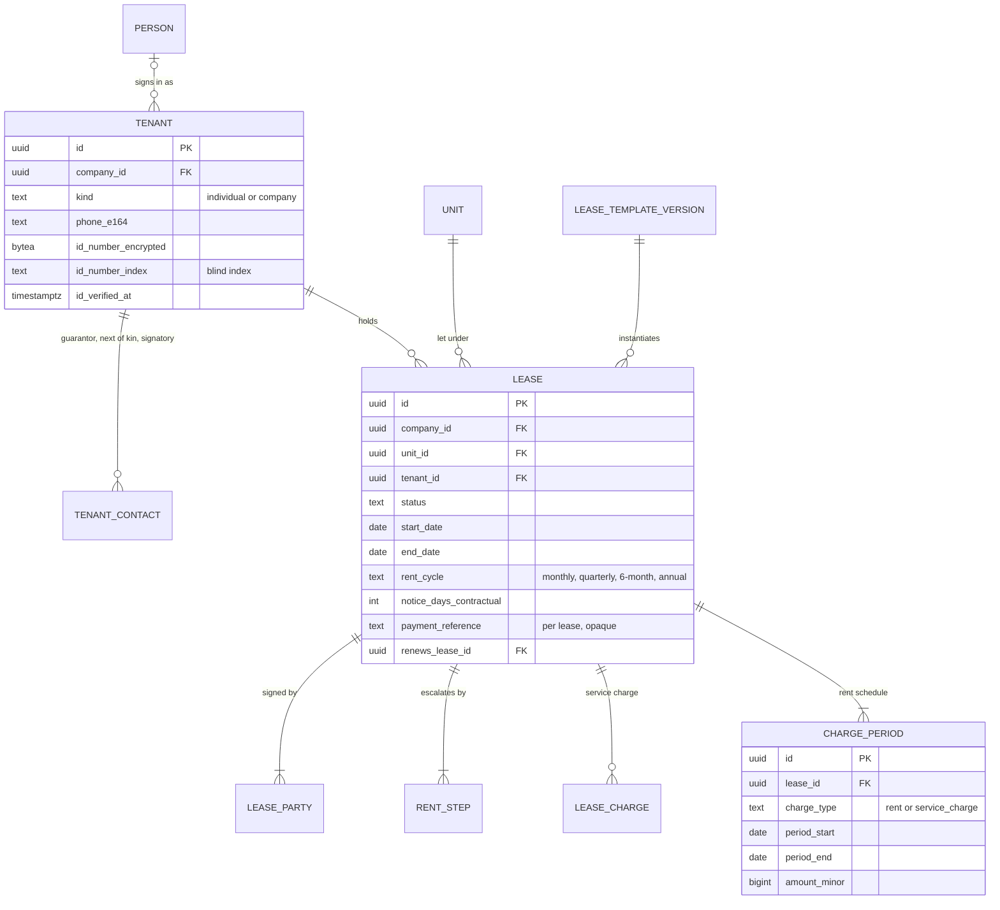

`CHARGE_PERIOD` is the rent schedule: one row per month and charge type, anchored on the lease start date, with escalations from `RENT_STEP` applied, whatever the billing cycle. It drives invoices, accrual and paid-until. A renewal is a new lease that points to the old one (`renews_lease_id`).

Built in M3 (`docs/plans/M3.md`, section 4; migrations `0006` to `0008`):

- **People.** A tenant record belongs to one company. An individual's record links by phone to a global `person` through `app.ensure_tenant_person`, which returns an id whether or not the person existed; `app.tenancies_for_person` returns company and tenant ids only, and only for the tenant the transaction acts for.
- **Leases.** Every lease starts as a draft. Triggers keep its unit, property and tenant fixed, freeze its terms (an allow-list of lifecycle and tracker columns) once it leaves draft, check each status change against the lease machine in section 7, freeze its parties, steps and charges with it, and allow a schedule only once it is signed. A `btree_gist` exclusion constraint stops two leases that hold a unit from overlapping. Cancelling a signed lease needs a second person's approval decision in the database.
- **Occupancy.** A definer trigger on lease status writes `occupancy` rows (source `lease`) to `unit_status_event`; the application role still cannot insert them. The `unit_occupancy` view (security invoker) gives each held unit's occupancy, and the register's displayed status reads it. While a lease holds a unit its availability is only "available" or "under repair", and it cannot be archived.
- **The schedule** is generated when a lease is signed (`LeaseLifecycleService.markSigned`, the one place a lease becomes signed). Holding over adds a month at a time at the last rate; after a short final period, the rest of that month first.
- **ID numbers and TINs** are encrypted with the field cipher (AAD: company, table, column, row), blind-indexed and stored masked; the audit triggers record them only as changed.

### 3.4 Billing, payments and ledger

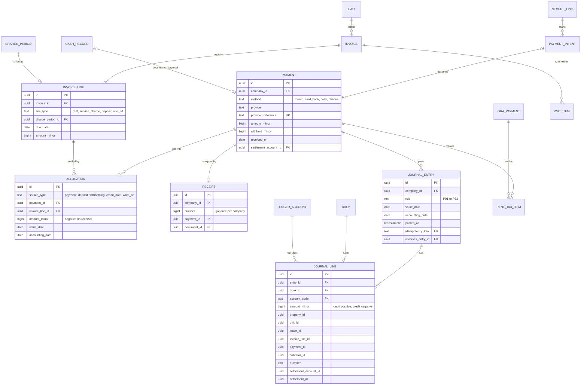

Receipt numbers come from a per-company counter row locked in the posting transaction, so they have no gaps. A reversed payment keeps its receipt and gets a credit receipt with its own number. `journal_entry.reverses_entry_id` is unique, so an entry can be reversed only once.

**As built in M4a** (migrations 0012 to 0014; M4a plan, section 5):
- **Tables:**
    - the ledger: `ledger_account`, `book`, `journal_entry`, `journal_line` and `period_lock`;
    - billing: `payment_reference`, `invoice`, `invoice_line`, `invoice_line_accrual`, `payment`, `payment_match`, `payment_reversal`, `receipt`, `company_counter`, `cash_record`, `direct_receipt`, `cash_banking`, `credit_carry_over`, `credit_note`, `write_off`, `allocation` and `idempotent_request`;
    - the register: `property_ownership_correction` (M2 S5).
- **Payments:** a payment row exists only once money is confirmed. Cash, cheques and direct transfers wait in their own records until a second person approves them. Provider payments start as a payment intent (one per charge attempt, from a pay link or the tenant app) and become a payment only once the provider's verify endpoint confirms the amount, currency, status and reference (M4b).
- **Who writes what:**
    - Books are made by database triggers when an owner or a landlord or agency company is created.
    - Books, the journal, period locks and every billing table are append-only, except the counters and the idempotency keys.
    - `lease.billing_start_date` is set once, when the lease is signed.

  The database refuses (`RA040` to `RA048`):
    - journal writes by any role but `ledger_writer`;
    - unbalanced books or entries with fewer than two lines;
    - an account outside its kind of book;
    - lines added to an entry from an earlier transaction;
    - lines in a locked month;
    - an owner change once a property has ledger entries;
    - a billing start set other than at signing;
    - an invoice for a lease already billed in another book.

**As built in M4b** (migrations 0018 and 0019; M4b plan, section 5):
- **Tables:**
    - settlement: `settlement_account` (bank accounts only, decision 2; the number encrypted with a blind index and a mask), `provider_subaccount` and `management_agreement` (effective-dated, one destination per owner in an agency, decision 6);
    - provider payments: `payment_intent`, `provider_settlement`, `reconciliation_exception` and `unmatched_refund` (P31);
    - delivery: `reminder_sent` (one row per invoice and ladder step) and `receipt_delivery` (channel, time sent and latency);
    - `webhook_inbox`: global, not company-scoped, unique on (provider, event id) among rows with a valid signature; written and read only through system paths;
    - new columns: `payment.provider_reference`, `settlement_account_id`, `payer_phone_index` and `payer_phone_masked`; `secure_link.invoice_id` and `receipt_id`; `message.owner_id`.
- **Row Level Security:** every new company table; property scope on intents, reminders and receipt deliveries; an owner's settlement account (and its subaccounts and settlements) only for people with that owner in scope, the agency's own account only for people who see the whole company.
- **System functions (ADR-002), ids and amounts only:** an intent by its reference, a settlement account by its provider subaccount, payments by provider reference or between two instants, companies with pending intents, and the inbox relay's claim.

  The database refuses (`RA051` to `RA054`):
    - a settlement account changed other than through its states (`awaiting_approval`, then `rejected` or `cooling_off` for 24 hours, then `active`, then `retired`), or a change of its holder, bank or number;
    - money matched while a refund of it is live, or a refund of money that belongs to a lease or was reversed;
    - a payment intent changed other than through its states, or once confirmed;
    - a pay or receipt link without its tenant.

  **Review fixes** (migrations 0020 and 0021):
    - `unmatched_refund` gains `sent`: approved, then sent while the provider makes it, then refunded or failed.
    - `provider_settlement.net_minor` may be below zero, and `charge_references` keeps the charges each settlement paid out.
    - `payment_intent` records an advance accepted over the limit under `warn` (`advance_over_limit`, the limit and the rule).
    - `webhook_inbox` keeps the body only for a valid signature. Otherwise it keeps `body_sha256`, `body_bytes`, three headers and a keyed hash of the sender's address.
    - `management_agreement.approval_request_id` names the request that set it.
    - The database refuses (`RA055`, `RA056`):
        - a reversal of money being or already refunded to its payer;
        - an agreement without a second person's approval.

### 3.5 Notices, signatures and messaging

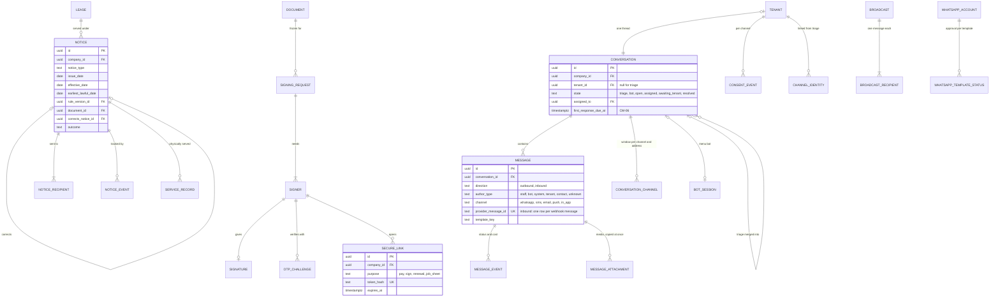

### 3.6 Maintenance, inspections and move-out

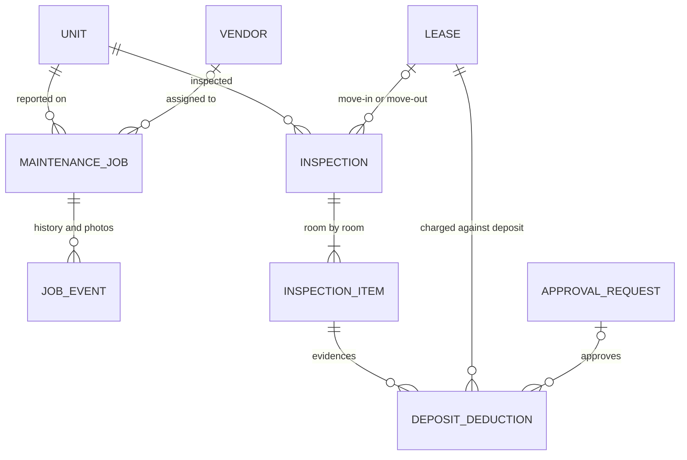

### 3.7 Platform, jobs and subscriptions

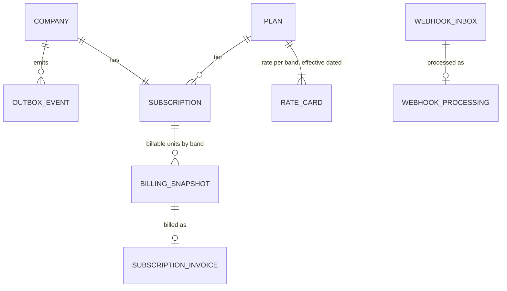

## 4. Ledger books and accounts

Each journal line belongs to a book. Every entry sums to zero within each book.

- **Owner book**, one per owner. Everything about the owner's property: tenant balances, deposits, prepayments, income, expenses, tax, fees and where the owner's cash sits.
- **Company book**, one per company. In the MVP it holds receipts that reach an agency's client account before anyone knows which owner they belong to (P23). In Phase 2 it carries the agency's own accounts (fee income, client money, AC-06).
- **Platform book**, the platform company's own book for subscriptions (M10). Rent never touches it.

Sign convention: debits positive, credits negative. Lines carry dimensions (lease, invoice line, payment, collector, provider, settlement account, settlement), which form the sub-ledgers; there are no per-tenant accounts.

**Two dates.** Every entry and every allocation has a value date (when it happened: money received, refund paid) and an accounting date (the period it is reported in). They are the same unless the value date falls in a locked period; then the accounting date is the first open day. Statements select by accounting date. Bank reconciliation, ageing and tax due dates use the value date.

| Code | Account | Type | Books | Notes |
| --- | --- | --- | --- | --- |
| 1010 | Own bank and MoMo accounts | Asset | Owner, company, platform | Money in the book owner's own accounts: settlements, remittances, direct transfers |
| 1050 | Payment provider clearing | Asset | Owner, company, platform | Confirmed payments not yet settled, less deductions not yet taken; dimensions provider and settlement |
| 1060 | Undeposited cash and cheques | Asset | Owner | Dimension collector: cash in hand per caretaker or manager |
| 1070 | Cash held by managing agent | Asset | Owner, company | The owner's money in the agency's client account |
| 1100 | Tenant receivables | Asset | Owner, platform | Earned and unpaid, per invoice line |
| 1150 | Withholding tax receivable | Asset | Owner | Withheld by a corporate tenant, certificate pending |
| 1160 | Withholding tax credits | Asset | Owner | Letting-business owners only, after the certificate |
| 2010 | Tenant prepayments | Liability | Owner | Received for periods not yet started, plus unapplied surplus, per lease. Its rent share is AR-03's unearned rent |
| 2020 | Deferred subscription revenue | Liability | Platform | Annual subscription prepayments |
| 2090 | Unmatched receipts | Liability | Owner, company | Suspense in the book of whoever received the money, until a person confirms the match (BC-12) |
| 2100 | Security deposits held | Liability | Owner | Per lease; never income (BC-11) |
| 2200 | Rent tax payable | Liability | Owner | Per receipt and line; due 30 days after the value date (TX-02) |
| 2210 | VAT and levies payable | Liability | Owner | VAT-registered commercial owners (P32, P33) |
| 2300 | Due to managing agent | Liability | Owner | Management fees not yet settled |
| 2400 | Refunds payable to tenants | Liability | Owner | Approved, not yet paid |
| 2500 | Supplier payables | Liability | Owner | Expenses incurred, not yet paid |
| 3900 | Opening balances | Equity | Owner | Pilot cut-over only (P25) |
| 4000 | Rent income | Income | Owner | |
| 4100 | Service charge income | Income | Owner | |
| 4200 | Other tenant charges | Income | Owner | One-off charges, agreed termination charges |
| 4300 | Deposit deductions retained | Income | Owner | Damage deductions with inspection evidence |
| 4600 | Subscription revenue | Income | Platform | |
| 5000 | Repairs and maintenance | Expense | Owner | |
| 5100 | Management fees | Expense | Owner | |
| 5200 | Payment processing fees | Expense | Owner, company, platform | |
| 5300 | Rent tax | Expense | Owner | Recognised per receipt (D9) |
| 5400 | Other property expenses | Expense | Owner | Rates, insurance, utilities paid by the owner |
| 5900 | Bad debts written off | Expense | Owner | Two-person approval |

## 5. Posting rules

"1010 or 1070" means 1010 when the money is in the owner's own account and 1070 when the agency holds it. Every rule posts in the same transaction as its business record, with an idempotency key of `<rule>:<record id>` (accruals use the invoice line id). Every allocation row records its source: payment, deposit, withholding, credit note or write-off.

| Rule | Event | Debit | Credit | Notes |
| --- | --- | --- | --- | --- |
| P01 | Invoice raised (BC-01) | none | none | Rent, service-charge and deposit lines are billing documents only; periods post when they start (P02) and deposits when received (P10). One-off lines (P2 charges, termination charges) post at issue: Dr 1100, Cr 4200. Deposit lines are raised when the lease is signed. VAT lines post at their tax point (P32). |
| P02 | Charge period starts (accrual) | 2010: the line's advance allocations plus surplus applied now 1100: the rest | 4000 (rent) or 4100 (service charge): the line amount | Per lease in one transaction, lines in accrual order (period start, rent before service charge). Surplus is applied first in, first out by payment. Catches up every started line not yet accrued; never a period after the lease's last billable day. **VAT and levies (M4a review 10):** the surplus left after the base line also pays its VAT and levy lines (Dr 2010, Cr 1100 on the tax line, under key `P02:<tax line>`); the forward walk expects the same, including the VAT of periods not invoiced yet. **Late draw (review 2):** a payment that arrived before a period started, for a period accrued since, is held as the line's advance by P03 and drawn at once (Dr 2010, Cr 1100), dated at the period start, under key `P02:<line>:<payment>`. |
| P03 | Provider payment confirmed and matched (BC-02, BC-03) | 1050: verified amount | 1100: started lines and one-off lines 2100: deposit lines 2010: lines not yet started, and surplus | Allocation oldest debt first (section 6). Each allocation is classified **as of the payment's value date** (the day the money arrived, also for a match of unmatched money), not the day it is recorded: a line not started on that day takes 2010, then the late draw of P02 if it has accrued since (review 2). A one-off or VAT line counts from the day it was charged (its P01 or P32 value date) in the same way. P17 and P14 follow in the same transaction. |
| P04 | Partial payment | as P03 | as P03 | The line stays partly outstanding. |
| P05 | Overpayment to credit (BC-07) | as P03 | as P03; surplus to 2010 | Surplus stays with its payment until P02 applies it. |
| P06 | Cash or cheque receipt approved (BC-05) | 1060 (collector) | as P03 | Nothing posts while the record awaits a second user's approval. |
| P07 | Cash banked or handed to the agent | 1010 or 1070 | 1060 (collector) | Slip photo and second-user approval (prd-issues 10). |
| P08 | Advance rent received (AR-01) | as P03, P06 or P28 | 2010 | The advance covers lines not yet started. P17 runs on its rent share (section 6). Months paid ahead are recorded; the AR-05 flag shows only when `advance_rent_policy` is `warn` or `block` (OQ-28). |
| P09 | Monthly recognition of advance rent (AR-01, AR-03) | 2010 | 4000 | Not a separate posting: it is the 2010 part of P02. |
| P10 | Security deposit received (BC-11) | as P03, P06 or P28 | 2100, for the deposit line | No rent tax, no management fee. |
| P11 | Deposit applied at move-out (MI-11, TL-11) | 2100 | 1100: unpaid rent or charges (allocation source: deposit) 4300: damage retained | Approved; never more than the deposit held. Rent settled from the deposit counts as rent received, so P17 and P14 run on it. |
| P12 | Deposit refund (TL-11) | approval: 2100 payment: 2400 | approval: 2400 payment: 1010 or 1070 | Paid outside the platform (D1) and recorded with reference and proof. |
| P13 | Early termination (AR-04) | apply: 2010 refund approved: 2010 refund paid: 2400 | apply: 1100, open lines oldest first refund approved: 2400 refund paid: 1010 or 1070 | First raise agreed termination charges (P01) and, where the lease allows, credit the unused part of the current month (P27). Then apply the prepayment to open lines. Refund only a positive remainder, with two-person approval. Lines still open stay as arrears: settle from the deposit (P11), collect, or write off (P24). Rent tax on refunded advance is not reversed automatically (OQ-19). |
| P14 | Management fee (AC-02) | 5100 | 2300 | Agency-managed owners only. Percentage fees per receipt on the agreement's base (prd-issues 18); fixed fees monthly per unit. |
| P15 | Expense (AC-03) | 5000 or 5400 (property, unit) | 2500 if unpaid, 1070 if paid by the agent, 1010 if paid by the owner | A payable paid later: Dr 2500, Cr 1070 or 1010. |
| P16 | Owner remittance (AC-05) | 1010: net amount 2300: fees retained | 1070: total | The agent pays the owner and keeps its fees in one entry. |
| P17 | Rent tax accrued (TX-01) | 5300 | 2200 (receipt, line, property) | Per receipt, at the rate for the unit's band, rule version recorded. Base: the receipt's rent share from the section 6 walk, including advances, plus its service-charge share while `rent_tax.includes_service_charge` is on (the default). Never deposits, VAT or surplus beyond the lease end. A line's tax never exceeds rate × line amount. Owners outside the letting business only (OQ-17 to OQ-19). Due by the rules row's days after the value date (`rent_tax.due_days_after_receipt`, 30 in the seed). A rules row missing or not one this build applies leaves the event not assessed: the money posts, the audit log records `rent_tax.not_assessed`, a person is alerted, and `tax.assess-pending` assesses it on the same key once the rules allow (M5 review 7). Credit carried to a renewal is taxed only on what was never taxed on the old lease (review N2). |
| P18 | Rent tax paid to GRA (TX-03) | 2200 | 1010 or 1070 | GRA receipt attached; settles specific rent tax items. |
| P19 | Withholding tax by a corporate tenant (TX-04) | 1150: amount withheld | 1100: the lines it was withheld on, months started (allocation source: withholding) 2010: months not yet started, on the line (M5 decision 8) | Recorded with the payment or when the tenant advises it later; the cash allocates normally (P03). A month not yet started holds it as its advance, as P03 holds a prepayment; when the month starts, P02 charges it in full and the withholding is drawn on its own key, `P02:<line>:withholding:<withholding>` (Dr 2010, Cr 1100). Tax on those lines becomes the amount withheld: P17 accrues it, rent tax already accrued on their cash is reversed, and the tax item is marked "withheld by tenant" so TX-02 alerts do not fire. Withholding recorded after the tenant's cash already paid the month (review 2): as much of that cash as the withholding needs returns to its payment's credit first, by allocation correction rows as a credit note releases money (Dr 1100 on a started month, or Dr 2010 on the line for one not started; Cr 2010 on the payment), in the same entry; the freed credit then pays later months in the usual order (a P02 credit draw for any month started and owed; the walk applies it to months not started). Rent tax: the tax on the moved cash is offset with the month's, the amount withheld becomes the month's tax, and the moved cash is taxed as it covers the months it now pays (a receipt item naming the withholding, `P17:<withholding>:<payment>`). A credit note never takes withheld tax back (M5 decision 9, OQ-56). |
| P20 | WHT certificate confirmed (TX-04) | owner outside the letting business: 2200 letting-business owner: 1160 | 1150 | Manager uploads, a landlord user confirms; the WHT item links to its rent tax items. A certificate that never comes is written off (P24). The debit follows what was recorded with the withholding (`rent_tax_treatment`; review 1): 2200 only when P17 accrued the amount withheld to 2200, else 1160; never the owner's flag at confirmation. |
| P21 | Reversal | (a) correction: each original line, sign flipped (b) payment reversal: 1100 for started lines, 2010 for lines not started and surplus, 2100 for deposit lines | (a) each original line, sign flipped (b) where the money now sits: 1050 if unsettled or to be deducted from a settlement, 1060 if not banked, 1010 or 1070 if banked (a provider payment once P22 has paid it out) | (a) only when nothing has consumed the entry since; otherwise (b) or P27. (b) covers chargebacks, bounced cheques and wrong matches. It is built from the current state of the payment's allocations, adds negative allocation rows, and mirrors the payment's P17 and P14 entries. A reversal is never itself reversed. |
| P22 | Provider settlement | 1010 or 1070: net received 5200: fees 1050: chargebacks and refunds deducted 2300: agent's share, when split at source | 1050: gross of the payments settled | One entry per settlement per book; lines carry the settlement id. Any difference from the provider's report raises a reconciliation exception. |
| P23 | Unmatched receipt, then matched (BC-12) | on receipt: 1050, or 1010 or 1070 for a direct transfer (P28) on match: 2090 | on receipt: 2090 on match: as P03 | Suspense sits in the book of whoever received the money: the owner's book when the account is theirs, otherwise the company book. When a match moves money from the company book to an owner book, the company book credits the asset now holding it (1050, or net cash and 5200 if already settled) and the owner book debits the same, so each book balances. A person confirms every match. |
| P24 | Write-off (AD-05) | 5900 | 1100 (allocation source: write-off), or 1150 for unrecoverable withholding | Two-person approval. |
| P25 | Opening balances (pilot) | arrears: 1100 prepayments: 3900 deposits: 3900 agent-held cash: 1070 withholding outstanding: 1150 rent tax outstanding: 3900 | arrears: 3900 prepayments: 2010 deposits: 2100 agent-held cash: 3900 withholding outstanding: 3900 rent tax outstanding: 2200 | Dated the cut-over. Arrears arrive as opening invoice lines at their original due dates, so ageing works. Prepayments arrive as an opening payment, so surplus rules apply. Tax items keep their due dates. The import file's fingerprint is recorded. |
| P26 | Platform subscription (M10, platform book) | invoice: 1100 payment: 1050 settlement: 1010 and 5200 annual release: 2020 | invoice: 4600, or 2020 when prepaid annually payment: 1100 settlement: 1050 annual release: 4600 | Same mechanics as rent, in the platform's own book. |
| P27 | Credit note: void, correction or early-termination proration | 4000, 4100 or 4200 | 1100 if the line was accrued and unpaid 2010 if accrued and paid (its allocations return to surplus) | Approval required. A line not yet accrued is cancelled with no entry; any allocations released stay in 2010. A replacement line accrues under its own key. Allocation source: credit note. |
| P28 | Direct receipt into an owner or agency account | 1010 or 1070 | as P03, or 2090 until matched (P23) | Bank transfers and MoMo sent straight to the landlord or agency, outside the provider. Recorded with proof and second-user approval; statement import comes in Phase 2. P17 and P14 follow. |
| P29 | Balances carried to a renewal lease | 2010 (old lease) 2100 (old lease) | 2010 (new lease) 2100 (new lease) | A change of lease dimension within the owner book. Arrears stay on the old lease's invoices. Credit and the deposit move payment by payment. Credit that appears on the old lease after the renewal started (a late payment) moves at once under `P29:<renewal>:<payment>`; money a credit note releases returns to the lease the payment's credit sits on. A reversal takes a carried deposit back from the lease holding it (review 9, 11). |
| P30 | Owner funds the agent | 1070 | 1010 | So the agent can pay expenses on the owner's behalf. |
| P31 | Unmatched receipt refunded to the payer | 2090 | 1050 for a provider refund, or 1010 or 1070 | In the book holding the suspense. Approval required. |
| P32 | VAT and levies on a commercial invoice (CT-04) | 1100: the invoice's VAT lines | 2210 | VAT-registered owners only; dwellings are exempt. Posted at the tax point, the invoice or the payment, whichever comes first (GRA guidance AG/26/001); an advance paid before its invoice exists creates the tax point at payment, which the tax adviser confirms (OQ-20). Rates come from `vat.commercial_rent` (unverified). VAT lines are allocated like any other line. Invoices a payment makes issue are charged at that payment's value date (second review A). |
| P33 | VAT paid to GRA | 2210 | 1010 or 1070 | With the VAT return; GRA receipt attached. |

### Worked example A: two-year residential advance

Lease from 1 Nov 2026 to 31 Oct 2028 at GH₵1,500 a month, self-managed individual landlord, no service charge. The tenant pays GH₵36,000 by MoMo on 25 Oct 2026. Provider fee F.

| Date | Rule | Owner book lines |
| --- | --- | --- |
| 25 Oct | P08 | Dr 1050 36,000 · Cr 2010 36,000 |
| 25 Oct | P17 | Dr 5300 2,880 · Cr 2200 2,880 (8% of 36,000) |
| 26 Oct | P22 | Dr 1010 36,000 − F · Dr 5200 F · Cr 1050 36,000 |
| 1 Nov | P02 | Dr 2010 1,500 · Cr 4000 1,500 |

After 1 Nov, the prepayment (2010) is GH₵34,500, all of it unearned rent, and paid-until is 31 Oct 2028. 24 months were paid in advance at receipt, against a 6-month cap; this is recorded, and flagged only if the company turns warnings on (OQ-28). Rent tax of GH₵2,880 is due by 24 Nov 2026.

### Worked example B: commercial tenant withholding tax

Office let at GH₵10,000 a month by an individual owner, managed by an agency at 10% of collections. The tenant company pays GH₵8,500 on 5 Nov and withholds GH₵1,500 on that month's rent.

| Date | Rule | Owner book lines |
| --- | --- | --- |
| 1 Nov | P02 | Dr 1100 10,000 · Cr 4000 10,000 |
| 5 Nov | P03 and P19 | Dr 1050 8,500 · Dr 1150 1,500 · Cr 1100 10,000 |
| 5 Nov | P17 | Dr 5300 1,500 · Cr 2200 1,500 (15% of 10,000, equal to the amount withheld) |
| 5 Nov | P14 | Dr 5100 1,000 · Cr 2300 1,000 |
| 6 Nov | P22 | Dr 1070 8,500 − F · Dr 5200 F · Cr 1050 8,500 |
| 20 Nov | P20 | Dr 2200 1,500 · Cr 1150 1,500 |
| 30 Nov | P16 | Dr 1010 7,500 − F · Dr 2300 1,000 · Cr 1070 8,500 − F |

Result: income GH₵10,000; rent tax GH₵1,500, settled by the withholding; fee GH₵1,000; provider fee F; the owner received GH₵7,500 − F. Every account except 1010 and the income and expense accounts is back to zero.

### The deposit at move-out: P11 and P12 as built (M8 plan 4.8)

- **One settlement, one transaction.** The `lease.move_out_settlement` approval runs, in order: the lease's end (Ended, or Terminated when early) and the credit notes for lines after it; when early, the agreed charges (P01) and the break-clause credit (P27); the credit applied to open lines (P13 apply); then the domain's final statement (`finalStatement`, which balances to zero); P11; P17 on the rent P11 settled; and the refunds payable (P13 for credit, P12 for the deposit).
- **P11** takes the deposit payment by payment, first in, first out (`P11:<move-out>`). Dr 2100 per deposit payment's share; Cr 1100 on each open line it pays, with an allocation of source `deposit` (record type `move_out`); Cr 4300 for the deductions retained. The deductions never exceed the deposit held: the domain checks it, and a trigger on `deposit_deduction` checks it against the lease's 2100 balance (RA086). Deductions the deposit can no longer cover after arrears are charged as a one-off line (P01) and stay owed.
- **P17 on P11.** Rent and service charge settled from the deposit count as rent received on the settlement day. They are taxed as a carry-over is, with the rent tax item kind `deposit_applied` and key `P17:P11:<move-out>`.
- **P12** approved (`P12:<move-out>:approved`): Dr 2100 per remaining share, Cr 2400. Paid (`P12:<move-out>:paid`): one entry for the whole refund, credit and deposit together, Dr 2400 and Cr 1010 or 1070, with its reference and proof (D1).
- **The sub-ledger.** Each share P11 or P12 takes is a `deposit_application` row (applied, retained or refund), and invariant 4 counts them. A move-out's credit refund keeps its shares per payment in `move_out_refund_part`, as M5's early terminations do in `early_termination_refund_part`.
- **A deposit settlement** (a lease already Ended or Terminated that still holds a deposit) runs the same steps without the end.

### Invariants (property-tested in M4a and M5)

1. Every entry sums to zero within each book.
2. Per invoice line, 1100 equals the line's outstanding amount once its period has started (one-off and VAT lines from issue); a line not yet started has no 1100 balance.
3. Per lease, 2010 equals allocations to lines not yet started plus every payment's unallocated remainder.
4. Per lease, 2100 equals deposits received less deposit-sourced allocations, deductions retained and refunds (M8: the `deposit_application` rows of P11 and P12), plus deposits carried in and less those carried out (P29).
5. For a lease with no refund, reversal, credit note or renewal carry-over, recognition from prepayments (P02) plus the 2010 balance equals everything prepaid.
6. The rent tax on an owner report equals the P17 entries, net of their reversals, whose accounting date falls in the period.
7. Per payment, allocations net of reversals, plus its unallocated remainder, equal the amount paid plus tax withheld.
8. Replaying any event with the same idempotency key changes nothing.
9. Paid-until moves backwards only through a payment reversal, a credit note or a change to the lease schedule.
10. A statement for a locked month regenerates with identical figures.
11. Per provider, 1050 equals payments not yet settled less deductions not yet taken, and matches the provider's unsettled balance.

## 6. Allocation, accrual and paid-until

**Allocation (BC-07).**
1. Allocation sources are payments (provider, cash, direct transfer, opening balance), deposits, withholding, credit notes and write-offs. Each row records its source, the line, the amount, a value date and an accounting date. Reversals add negative rows; nothing is updated.
2. Withholding is pinned to the lines it was withheld on, started or not (a month not yet started holds it as its advance, M5 decision 8). Everything else is allocated oldest debt first: open lines ordered by due date, so across invoices the oldest goes first. Within one due date (one invoice) the order is the deposit, then the charge periods month by month (each month's rent, then that month's service charge), then one-off charges, with each VAT or levy line straight after the line it is charged on (M4b decision 9). A pay link for a particular invoice does not change the order.
3. Deposit lines are raised when the lease is signed, so an early deposit always finds its line and never becomes surplus.
4. Whatever a payment does not allocate stays as that payment's unallocated remainder (surplus) in 2010.
5. A correction never leaves credit beside reopened debt (M4b review F4). After a reversal or a credit note, spare credit, oldest payment first, pays any accrued rent or service-charge period left owing, by a P02 credit draw dated that day. Deposits and one-off charges are not drawn.

**Accrual (daily, after invoice generation).**
1. Charge periods are monthly, anchored on the lease start date, whatever the billing cycle; an annual invoice bundles twelve of them.
2. Each run takes, per lease, every rent and service-charge line whose period has started and is not yet accrued, so a missed day catches up. Lines go in accrual order (period start, then rent before service charge), in one transaction per lease.
3. For each line, surplus is applied first in, first out by payment, up to the line's outstanding amount. P02 then debits 2010 for the line's advance allocations plus the surplus just applied, and 1100 for the rest. Withholding held as the line's advance (M5 decision 8) is then drawn on its own key: Dr 2010, Cr 1100. Paid-until, reminders, ageing and the invoice list count withheld tax as covering its line.

**Paid-until (AR-02) and the forward walk.**
1. Walk the lease's recurring lines (rent and service charge) in accrual order. A started line is covered if its allocations equal its amount. A future line is covered by its advance allocations plus surplus applied forward, in the order P02 will use.
2. Paid-until is the last day of the last month in which every recurring line is covered, in an unbroken run from the start. If the next month is partly covered, show "plus GH₵X towards the month starting …".
3. The same walk splits each receipt into rent, service charge and surplus beyond the lease end. P17 taxes the rent share, and the lease page shows the rent share of 2010 as unearned rent (AR-03).

**Arrears and ageing (BC-08).** Invoice lines past their due date with an amount outstanding, bucketed 0–30, 31–60, 61–90 and 90+ days from the due date, by tenant, property and owner, as of any accounting date.

## 7. State machines

### Unit status (PR-06, PB-09)

Displayed status combines derived occupancy with manually set availability (prd-issues 21).

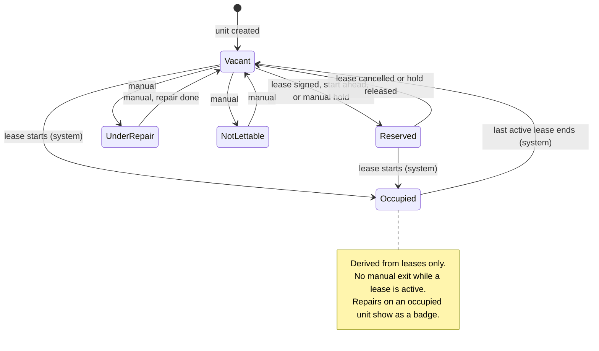

### Lease (TL-05 to TL-11)

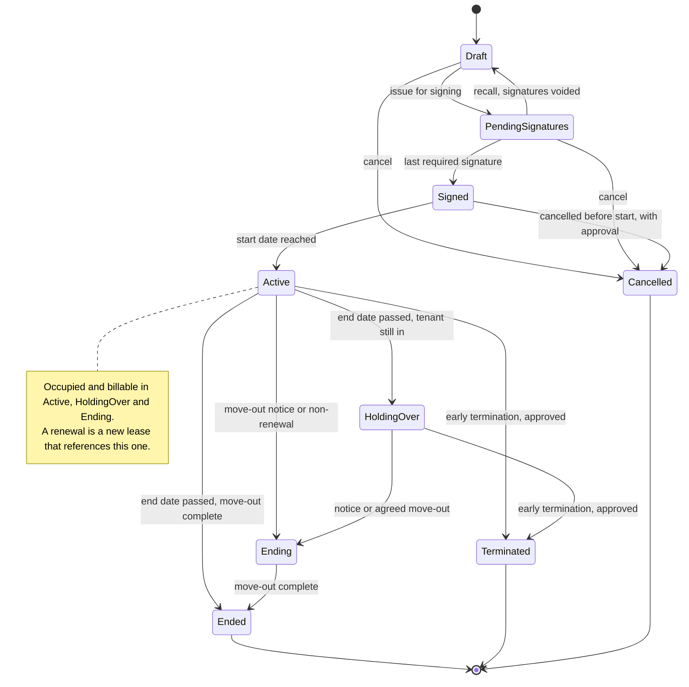

### Invoice (BC-01, BC-07)

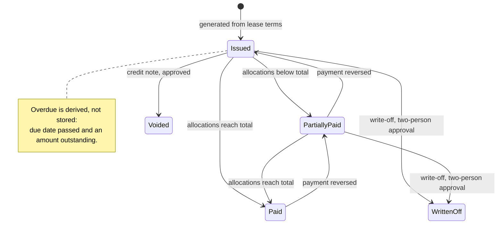

### Payment (BC-02 to BC-07, BC-12)

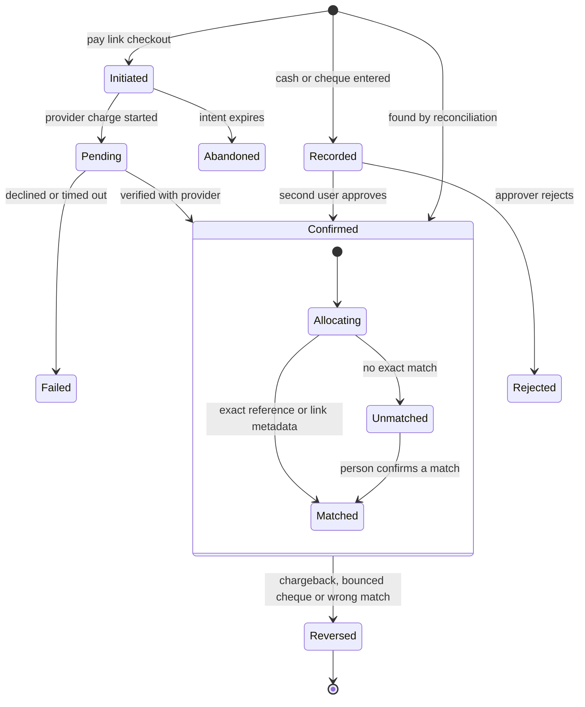

### Approval request (AD-05)

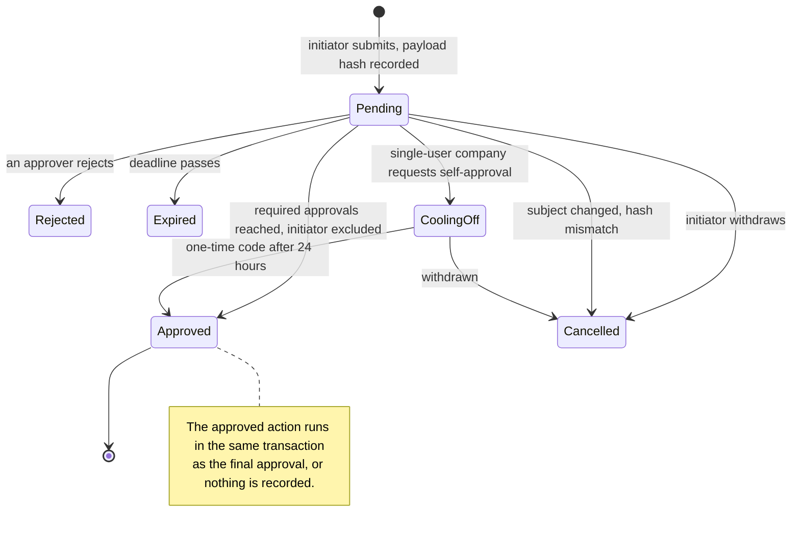

### Notice (LN-01 to LN-09)

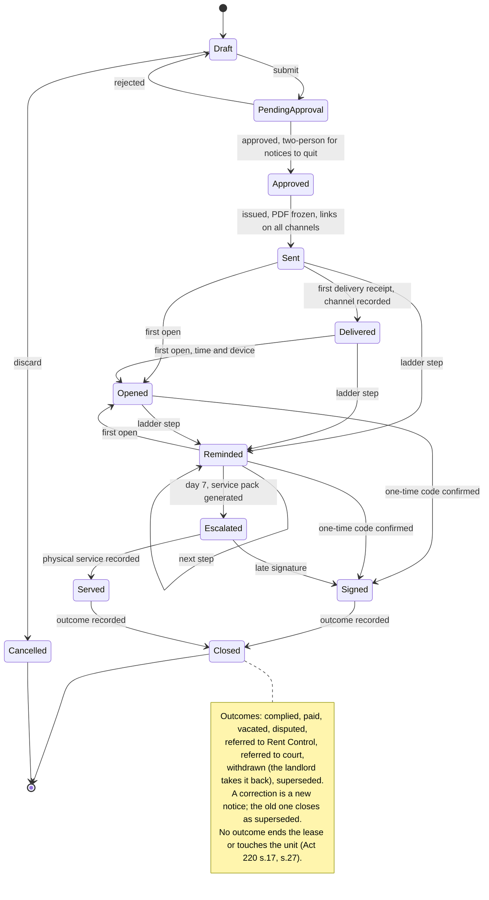

The status shows the furthest point reached; every event is also kept in `notice_event` with its timestamp (LN-03). Pausing or cancelling the ladder (LN-05) is a flag on the notice, not a state. For commercial tenants (LN-07) each recipient has its own events, and the notice is Signed when any authorised signatory signs.

### Maintenance job (MI-01 to MI-06)

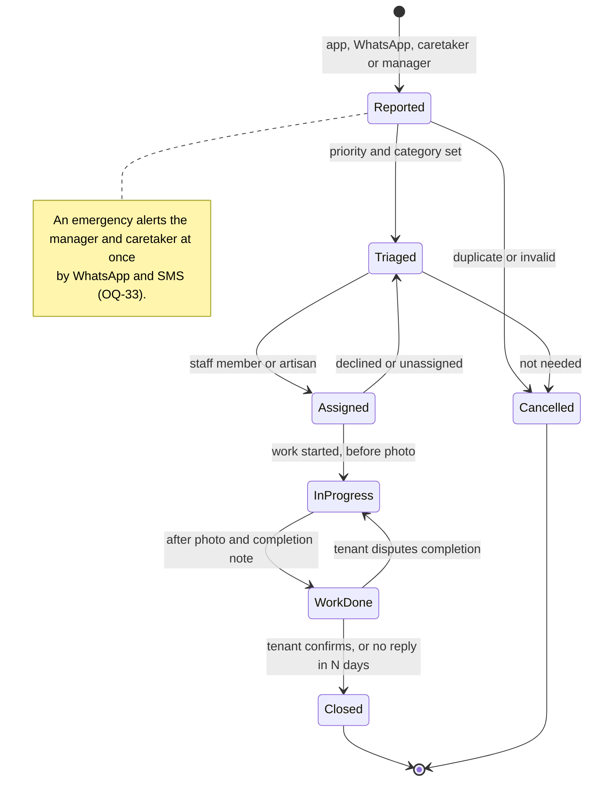

### Conversation (CM-02 to CM-06)

There is one thread per tenant (CM-05). This machine tracks the thread's working state.

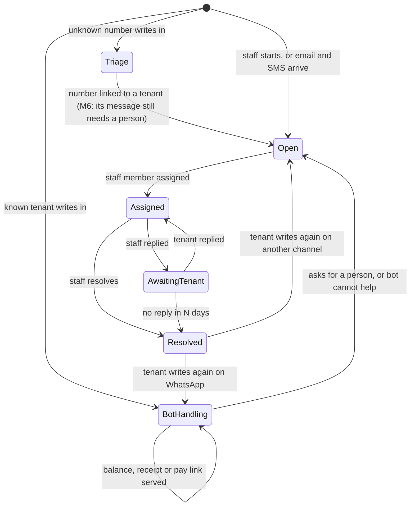

The machine is `applyConversationEvent` in `packages/domain/src/messaging/inbox.ts` (M6). It also sets the response deadline: from the tenant's message, or the bot's handover, when no reply is owed yet; cleared by a staff reply or resolving (decision 10). M6 changed one arrow: a linked triage conversation goes to Open, not to the bot, because the message that was in triage has not been answered.

### Subscription (PB-07 to PB-11)

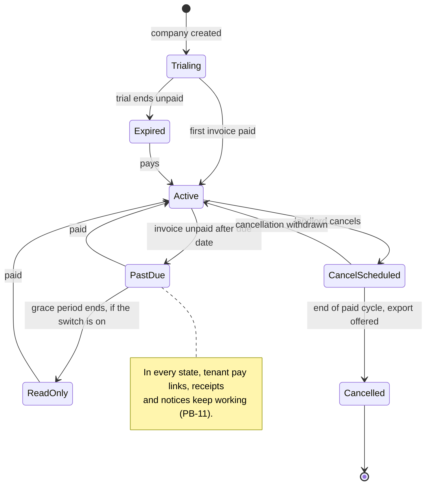

## 8. Payment flow

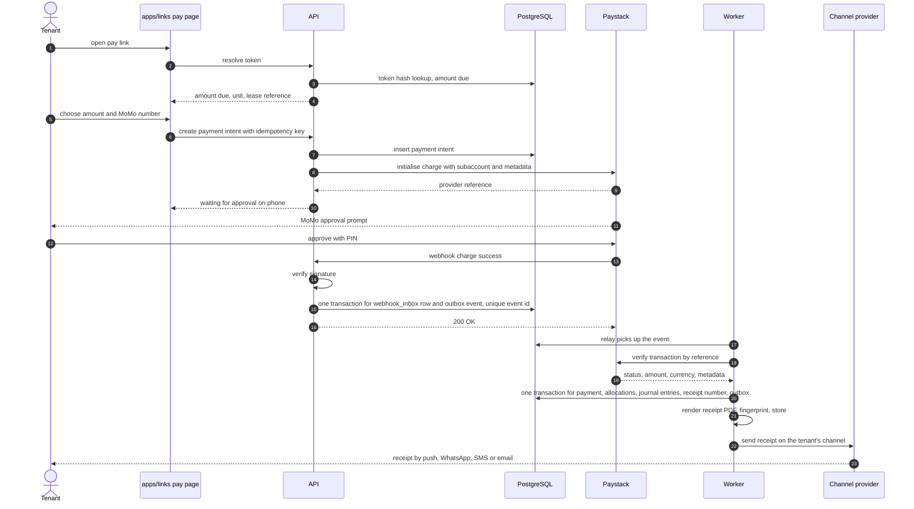

| Situation | What happens |
| --- | --- |
| Webhook signature invalid | Stored as rejected; nothing posts; security alert. |
| Duplicate webhook | Unique (provider, event id) makes it a no-op. |
| Verify call fails or times out | Retried with backoff (1 minute up to 1 hour, 10 tries), then dead-letter and alert. The intent stays pending for the polling job. |
| Provider reports failed or abandoned | Intent marked failed; the tenant can retry from the same link. |
| Verified amount differs from the intent | Post the verified amount (the money actually received), allocate normally, flag for review. |
| Provider payment with no intent or metadata | Unmatched queue with ranked suggestions (amount, phone, date, history); P23 suspense until a person confirms. |
| Tenant pays straight into the landlord's bank or MoMo | Staff record it with proof and a second user approves (P28); statement import comes in Phase 2. |
| Webhook never arrives | `payments.verify-pending` checks intents pending over 5 minutes; reconciliation catches the rest the next day. |
| Provider down when creating the charge | Fail over to the second provider only if it settles directly (D1). Otherwise show "try again shortly" plus the landlord's manual payment instructions, and raise an incident alert. |
| Receipt send fails | Retried, then the next channel. The receipt stays available in the app and on the link. |
| Chargeback or provider reversal | P21(b) payment reversal, built from the current state of its allocations, when the money taken back equals the payment (a part is an exception). A credit receipt is issued, and an alert goes to the people who see that property. It needs no approval: the provider has already taken the money back. The money sits in 1050 until the next settlement deducts it (M4b). |

**Daily reconciliation** (02:00 Africa/Accra). List the provider's transactions for the previous day. Each one missing locally goes through the normal processing path. Each local payment the provider does not list is flagged. Charges listed as reversed, and the day's refunds and disputes, go through the chargeback path. Then match settlement reports to payments and post P22, and raise any difference as an exception on the manager dashboard. A payment posted after its settlement was reconciled is settled when it appears. Last, provider clearing (1050) per settlement account is compared with what the provider still holds unsettled (invariant 11).

**As built in M4b, after review:**
- **Money:**
    - only cedis are posted: a charge in another currency is an exception on every path;
    - a refund posts P31 only once the provider says it is processed, and a retry always asks the provider first;
    - a reversal equal to the payment reverses it; a part refund or chargeback is an exception.
- **Failover:** only a clear "down" (503, 429) moves to the next provider. After a timeout or any other unclear answer, the same provider is asked about the charge first.
- **Card return page:** the checkout returns the payer to `${LINKS_ORIGIN}/p/return?reference=…`, which carries the charge reference, never a pay-link token.
- **Webhook intake:**
    - bodies over 64 KB are refused;
    - bad-signature requests are rate-limited per address and keep no body;
    - their alert goes at most once per provider in 15 minutes.

## 9. Secure links and e-signature

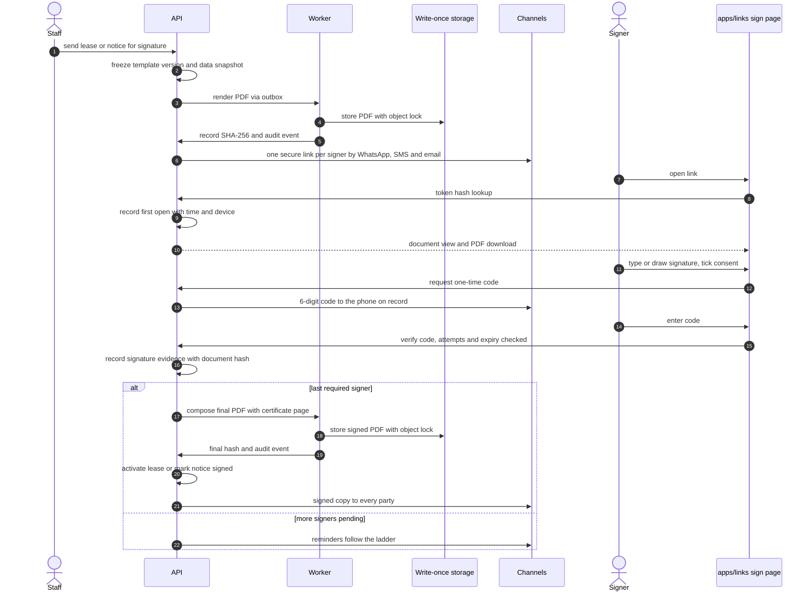

- **Tokens.** 256 random bits in the URL; only the SHA-256 hash is stored. Purpose-scoped (pay, sign, renewal, job sheet) and recipient-scoped. Expiry by purpose: signing links 30 days, notice links when the notice period ends (LN-02) or 90 days for notices without one, pay links when the invoice is settled or after 60 days.
- **One-time codes.** 6 digits, hashed, 10-minute validity, 5 attempts, then a cooldown before a new code. Sent to the phone on record (email only for email-only signatories, prd-issues 26). WhatsApp authentication templates serve as fallback when SMS fails.
- **Evidence per signature.** Typed name or drawn image, consent text version, server time, verified phone or email, IP address, user agent, document SHA-256.
- **Certificate page.** Signer names, roles, timestamps, verification method, IP and device, and the original document's SHA-256. The final PDF's own hash is recorded in the database and the audit chain, and sent to every party with their copy.
- **Failure paths.** An expired or reused token shows an explanation page and the landlord's contact. Too many code attempts lock signing for 30 minutes. A lease signer may decline (lease returns to Draft); a notice cannot be declined, only left unsigned, which the ladder handles.
- **The links API (M3).** `apps/links` calls the API server to server (`/links/open`, `/document`, `/code`, `/sign`, `/decline`) with a shared key in `x-links-key` (`LINKS_API_KEY`, required in production), passing the browser's address and device as evidence; the token is the only authorisation for the page. On the page the signer asks for the code first, then submits the code, the typed name or drawing and the consent tick together. A signer's signed copy goes out on a link of its own (`signed_copy`). The signed copy is the frozen PDF with the certificate appended as an incremental update, so the frozen document's bytes stay a prefix of it.

## 10. Job catalogue

All jobs run in `apps/worker` on pg-boss. Each sets the company context from its payload before touching data. Idempotency is enforced twice: a pg-boss singleton key on the job, and a unique constraint on the business effect (a journal idempotency key, a reminder-sent row, a receipt per payment).

| Job | Trigger | Idempotency key | Retries | Milestone |
| --- | --- | --- | --- | --- |
| `outbox.relay` | LISTEN/NOTIFY, 1-second poll fallback | outbox event id | continuous; at-least-once, consumers idempotent | M1 |
| `audit.verify-chains` | nightly 01:00 | company + date | 3, alert on failure or mismatch | M1 |
| `audit.anchor-heads` | daily 01:30 | date | 5 | M1 |
| `documents.render-pdf` | event: document requested | document id | 5, backoff from 30 s | M1 |
| `approvals.expire-requests` | hourly | request id + expiry | 3 | M1 |
| `portfolio.process-property-file` | event: photo or paper uploaded | property file id | 5, backoff from 30 s | M2 |
| `portfolio.import-validate` | event: import dry run requested | import id + request time | 3, then the import is marked failed | M2 |
| `portfolio.import-commit` | event: import committed | import id + the check it follows (validated at) | 3, then the import is marked failed | M2 |
| `housekeeping.expire-links-and-codes` | hourly: revokes expired links and links of closed requests, lifts finished code locks | run hour | 3 | M3 |
| `identity.verify-id` | event: ID captured | tenant id + attempt | 5, then manual review | M3 |
| `tenancy.lease-transitions` | daily 00:05 | lease id + transition + date | 5 | M3 |
| `tenancy.renewal-reminders` | daily 08:00 | lease id + days before (90, 60, 30) | 3 | M3 |
| `tenancy.rent-control-reminders` | daily 08:00 | lease id + reminder step | 3 | M3 |
| `tenancy.stamping-reminders` | daily 08:00 | lease id + reminder step | 3 | M3 |
| `tenancy.formal-lease-reminders` | weekly | lease id + week | 3 | M3 (terms over three years; OQ-44) |
| `esign.signing-reminders` | every 15 min, one company job per 15-minute slot | signer id + ladder step | 3 | M3 |
| `esign.finalise` | event: last signature | signing request id | 5 | M3 |
| `documents.rendered` | event: a PDF is recorded with its SHA-256 (emitted by `documents.render-pdf`); opens the signing request and queues its links | render request id | 5 | M3 |
| `signing.completed` | event: a signing request finalised; marks the lease signed (`LeaseLifecycleService.onSigningCompleted`) | signing request id | 5 | M3 |
| `signing.declined` | event: a signer declined; returns the lease to draft (`onSigningDeclined`) | signing request id | 5 | M3 |
| `billing.generate-invoices` | daily 00:10; fans out one `billing.generate-invoices.company` job per company | lease id + cycle start | 5 | M4a |
| `billing.accrue-periods` | daily 00:20, after invoices; catches up any missed day; fans out per company | invoice line id | 5, alert | M4a |
| `billing.subledger-check` | nightly 03:00; fans out per company | company + date | 3, alert on mismatch | M4a |
| `lease.signed` | event (tenancy): issues the payment reference, the deposit invoice and any cycle already due, then accrues | event id; invoice per lease + cycle start | 5 | M4a |
| `lease.activated` | event (tenancy): a renewal starts, so prepayments and the deposit carry over (P29) | event id; `P29:<new lease>` | 5 | M4a |
| `lease.ended` | event (tenancy): a system credit note cancels lines for periods after the end | event id; one credit note per line | 5 | M4a |
| `lease.cancelled` | event (tenancy): a signed lease cancelled before it starts; its lines are credited | event id; one credit note per line | 5 | M4a |
| `billing.rent-reminders` | daily 08:00; fans out one `billing.rent-reminders.company` job per company | invoice id + ladder step (a reminder row per step) | 3 | M4b |
| `payments.process-webhook` | a stored `webhook_inbox` row, published by the inbox relay in the worker (LISTEN `webhook_inbox`, 1-second poll; claim and enqueue in one transaction) | inbox id; unique (provider, event id) | 10, 1 min to 1 h, then dead letter: the row is marked failed | M4b |
| `payments.verify-pending` | every 5 min; fans out one `payments.verify-pending.company` job per company with intents pending over 5 minutes | company + 5-minute window; a confirmed intent is final | 3 | M4b |
| `payment.posted` | event (payments): the receipt delivery, on the tenant's consented channels with a receipt link; the latency from confirmation is recorded per receipt, with an alert past 60 s | receipt id; one delivery per receipt | 5, from 5 s | M4b |
| `payments.reconcile-transactions` | daily 02:00, each configured provider, the previous day | provider + date; each missing payment through the normal path | 5 | M4b |
| `payments.reconcile-settlements` | daily 02:30, each configured provider | provider + settlement id; P22 key per settlement and book | 5 | M4b |
| `settlement_account.approved` | event (payments): an approved settlement account becomes active once its 24 hours have passed (re-queued for then), and gets a subaccount with each provider that settles directly | account id | 5 | M4b |
| `payments.refund-unmatched` | event (payments): an approved refund of unmatched money (P31) is sent to the provider, after asking it for any refund already made. While the provider is still making it, the job runs again every 10 minutes until the provider or its webhook says processed or failed | refund id | 5 | M4b |
| `billing.paid-until-prompt` | daily 08:00 | lease id + paid-until date | 3 | M5 |
| `tax.assess-pending` | daily 07:30 | the event's P17 key (`rent_tax.assessed` in the audit log) | 3 | M5 review 7 |
| `tax.rent-tax-alerts` | daily 08:00 | tax item id + alert day (21, 28) | 3 | M5 |
| `messaging.send` | event: message queued | message id | 5 per channel, then the next (push, WhatsApp, SMS, email) | M3 (SMS and email, M3 decision 1); WhatsApp and push in M6 |
| `messaging.process-inbound` | a stored `webhook_inbox` row for a messaging provider (Meta, Hubtel, Postmark), one per message or status in a batch | provider + message or status id; unique inbound `(provider, provider_message_id)` and one `delivered`/`read` event per message and channel | 10, then dead letter | M6 |
| `messaging.fetch-media` | event: inbound media | provider media id; unique `(provider, provider_media_id)` attachment | 5 | M6 |
| `messaging.broadcast-fanout` | event: broadcast confirmed; batches of 50, throttled per provider | broadcast id + batch | 5 | M6 |
| `messaging.sla-check` | every 5 min, per company | conversation id + deadline (`overdueAlertKey`) | 3 | M6 |
| `messaging.sync-templates` | daily 06:00, and Meta's template webhook | number + template + day | 3 | M6 |
| `messaging.push-receipts` | every 15 min | push ticket id | 3 | M6 |
| `notices.ladder` | every 15 min | recipient id + ladder step | 3 | M7 |
| `notices.escalate` | ladder day 7 | notice id | 5 | M7 |
| `maintenance.emergency-alert` | event: emergency reported | job id | 5, SMS fallback | M8 |
| `maintenance.sla-check` | every 15 min | job id + target | 3 | M8 |
| `reporting.owner-statements` | monthly, 1st at 06:00 | owner id + month | 5 | M9 |
| `reporting.metrics-rollup` | daily 04:00 | company + date | 3 | M9 |
| `reporting.fixed-fees` | 23:00 from the 28th to the 1st; posts on the company's last day of a month, and on the 1st for last month | owner + unit + month (`P14:<owner>:<unit>:<month>`) | 5 | M9 |
| `reporting.fee-check` | daily 03:15 | company + date; read-only, alerts `reporting.fee_mismatch` | 3 | M9 |
| `ledger.agent-cash-check` | daily 03:30; fans out per company | company + date; read-only, alerts `ledger.agent_cash_negative` (critical) when an owner book's 1070 is below zero (F3: payments out of it are refused beyond what is held, but a chargeback cannot be) | 3 | M9 |
| `subscription.snapshot` | monthly, 1st at 00:30 | company + month | 5 | M10 |
| `subscription.invoice` | monthly, 1st at 01:00 | company + month | 5 | M10 |
| `subscription.dunning` | daily 09:00 | invoice id + step | 3 | M10 |

Sign-in codes are not a job: the auth request sends them straight to the SMS port, with no transaction open, so a plaintext code is never written to the outbox or the queue (M1). Times are Africa/Accra. Schedulers enumerate companies through a system function that returns company ids only (ADR-002), then enqueue one company-scoped job each.

## 11. Security model

### Authentication

| User | Sign-in | Second factor | Session |
| --- | --- | --- | --- |
| Owner, agency admin, manager, accountant, adviser | Email and password (Better Auth) | TOTP, mandatory; backup codes | httpOnly secure cookie; idle 30 min, absolute 12 h; device list with remote sign-out |
| Platform admin | Email and password | TOTP, mandatory | Idle 15 min; a company's data only under an active support grant |
| Caretaker | Phone one-time code | The phone itself | Web session, idle 30 min; device-bound tokens when the field app ships |
| Tenant (Expo app and web) | Phone one-time code by SMS or WhatsApp | The phone itself | Database session, revocable on the next request; token in secure storage; idle 30 days, absolute 180 days (M1 plan, decision 6); device list |
| Commercial tenant user (P2) | Email and password | TOTP optional | As staff |
| Secure link recipient | Link token | One-time code to sign or complete a job | No session beyond the page |
| Provider webhooks | HMAC signature | Event id uniqueness, timestamp tolerance, IP allowlist where published | n/a |

### Authorization

- `PolicyService.can(actor, action, resource)` is the only authorization path: NestJS guards for routes, explicit calls for resource-level checks. Role-to-permission mapping is code in the MVP and a per-company matrix in Phase 2 (AD-04).
- Scopes inside a company: owner (AD-02), property assignment (caretakers, artisans), tenant (own records only), adviser (read-only, nominated owner).
- A lint rule rejects role comparisons outside the `policy` module. A test matrix covers every role against every MVP action.

### Row Level Security

- Company isolation as in `CLAUDE.md` section 5: forced RLS, a non-owner application role without BYPASSRLS, transaction-local `app.company_id`.
- System paths, each granted narrowly:
    - **Webhook intake** writes to the global `webhook_inbox`, resolves the company from the provider subaccount or metadata, then enqueues a company-scoped job.
    - **Schedulers** call a `SECURITY DEFINER` function that returns company ids only.
    - **Platform admin aggregates** read `SECURITY DEFINER` views that return counts and totals, never rows.
    - **Support access** sets a company context only when an active, consented, time-boxed grant exists. Every query under it is audited.
- Defence in depth: a second, restrictive RLS policy limits scoped sessions to their scope. M2 applies it to the register: the request transaction sets `app.property_scope` (the properties a person's owners hold today, plus those assigned to them) and `app.owner_scope`, and every register table filters on them; NULL means the whole company. M3 adds the same property policy to every tenancy, e-signing and messaging table with `property_id`, and tenant scope: a tenant-app transaction sets `app.tenant_scope` to the person's tenant records in that company, every table with `tenant_id` filters on it, a tenant session sees issued leases only and never templates, links or codes, and its property scope is the properties of its own leases (no owner records). Scoped staff see a tenant through its leases on in-scope properties, or as its creator before it has any lease.

  M4a extends the policies to the ledger and billing:
    - **Property scope:** journal lines and every billing table with `property_id`.
    - **Payments:** follow the property or owner they belong to, or a match to an in-scope lease.
    - **Books:** visible within the owner scope.
    - **Banking:** visible to its collector and within the owner scope.
    - **Idempotency keys:** each person sees only their own requests.
    - **Tenant sessions:** read their own invoices, lines, allocations, payments and receipts. They read no journal row, book, cash record or correction.

  M6 extends them to messaging:
    - **Conversations** follow their tenant: scoped staff see one through the tenant's leases on their properties, a tenant session sees only its own, and triage (no tenant yet) only people who see the whole company.
    - **Attachments** follow their message; a tenant session reads those of its own messages.
    - **Staff only:** channel activity, bot sessions, reply addresses, unsubscribe tokens, linked identities, tenant groups and broadcasts.
    - **Narrow system functions:** `companies_for_phone` and `recent_whatsapp_companies` (shared-number routing: company ids and names only), the `whatsapp_*` functions (numbers and template statuses), `reply_address_company` and `unsubscribe_token_company` (a token's hash to its company), `register_push_device`, `unregister_push_device` and `push_tokens_for_tenant` (a person's tokens only to a company where they are a tenant), and `company_plans` and `set_company_plan` (platform admins only).
    - **Live inbox:** a trigger NOTIFYs channel `inbox` with ids only (company, conversation, message).

  Journal writes need `SET LOCAL ROLE ledger_writer`. `rent_app` is a member with `INHERIT FALSE`, so it gains no privilege from the role without switching to it.

### Data protection

- Envelope encryption with KMS for ID numbers and account numbers; data keys rotated yearly; blind index (HMAC-SHA-256) for lookups; masked display.
- Logs: structured, request ids, redaction of phones, emails, ID numbers, codes, tokens, signatures and bodies.
- Secrets: the cloud secrets manager per environment; provider keys never reach a client.
- Rate limits: sign-in, code send and verify, link open, public pay endpoints, webhook endpoints.
- Transport and headers: TLS 1.2 or later, HSTS, strict CSP on `apps/links` with no third-party scripts.
- Uploads: presigned PUT with size and type limits; images re-encoded server-side, with EXIF location stripped from tenant uploads; malware scanning added in M11.
- Backups: daily snapshots, 30-day point-in-time recovery, cross-region copies, quarterly restore drill (M11).
