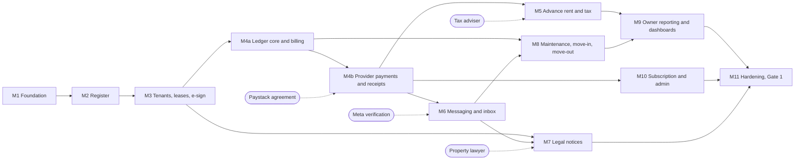

# Roadmap

The playbook's milestone sequence stands, with three changes. M4 splits into M4a and M4b. AR-01 to AR-03 move into M4a. Every milestone reflects the Expo tenant app (D4). Every MVP requirement maps to at least one milestone (coverage below); none is left uncovered.

## Changes to the playbook sequence

1. **M4 splits into M4a and M4b.** As written, M4 holds the ledger, billing, allocation, cash, deposits, two provider adapters, webhooks, matching, reconciliation, receipts, reminders and eight screens. That is too much to plan, build and review in one milestone, and it is the milestone customers pay for. M4a proves the ledger model with recorded and fake payments. M4b connects real providers.
2. **AR-01 to AR-03 move into M4a.** Under the accrual-by-period model (ADR-003), applying prepayments as periods start is part of the ledger core, not an add-on. M4's own tenant home screen already shows paid-until (AR-02). M5 keeps AR-04 to AR-06 and tax.
3. **Cash banking (P07) joins M4a** (prd-issues 10). Without it, approved cash never leaves the collector's balance.
4. **Payment references are per lease** (prd-issues 15), generated in M4a, not derived from the unit code.
5. **Expo tenant app** (ADR-010). M1 builds the shell and phone sign-in; tenant screens arrive with the features they show. No-login pages live in `apps/links`.
6. **M1 includes the Better Auth spike** (ADR-011) and the single-user approval mode (prd-issues 8).

## Sequence

Run order for one Claude Code thread: M1, M2, M3, M4a, M4b, M5, M6, M7, M8, M9, M10, M11. With a second engineer, M6's adapters and inbox can start after M4a, using the fake providers.

| Milestone | Requirement IDs | Depends on | Riskiest part |
| --- | --- | --- | --- |
| M1 Foundation | AD-01, AD-03, AD-05, AD-06, AD-07, TX-08 (engine); NFR security, audit, localisation, backup configuration | none | RLS context under pooled connections and in jobs; the Better Auth spike; Expo inside a pnpm and Turborepo monorepo |
| M2 Register | PR-01 to PR-06, PR-08, PR-09, AD-02, PB-01 | M1 | Unit code format and stability; idempotent Excel re-import; occupancy derived, not stored |
| M3 Tenants, leases, e-sign | TL-01 to TL-07, TL-09, PB-09, TX-05; AR-05 behind `advance_rent_policy`, off by default (OQ-28) | M2 | E-signature evidence and freezing; ID encryption and reveal; the lease terms and rent schedule that billing depends on |
| M4a Ledger core and billing | AC-01, BC-01, BC-05, BC-07, BC-08, BC-11, AR-01, AR-02, AR-03; P07 cash banking; per-lease payment references; CT-04 VAT on commercial invoices (P32) | M3 | Posting rules and the period accrual job staying consistent with allocations (invariants in `docs/architecture.md`, section 5) |
| M4b Provider payments and receipts | BC-02, BC-03, BC-04, BC-06, BC-09, BC-12 | M4a | Webhook verification and reconciliation; gap-free receipts under concurrency; the second provider meeting D1 |
| M5 Advance rent and tax | AR-04, AR-05, AR-06, TX-01, TX-02, TX-03, TX-04, TX-08 (tax rules); VAT returns (P33) | M4b | Tax rules still unconfirmed (D9, OQ-17 to OQ-19); refund edge cases |
| M6 Messaging and inbox | CM-01 to CM-03, CM-05 to CM-10, CM-04 stub; message cost recorded (CM-12 groundwork) | M4b | Meta verification and template approval lead times; 24-hour window logic; consent |
| M7 Legal notices | LN-01 to LN-05, LN-07, LN-09; CF-06 tasks in the web app | M3, M6 | Notice periods unverified (OQ-09, OQ-16); ladder timing; evidence quality |
| M8 Maintenance, move-in, move-out | MI-01 to MI-04, MI-06, MI-10, MI-11, CM-04, TL-08, TL-11; AC-03 (moved from M9, M8 decision 8) | M4a, M6 | Deposit deductions and the final statement balancing to zero |
| M9 Owner reporting and dashboards | AC-02, AC-04, AC-05, DA-01, DA-02, DA-06; Gate 1 metrics | M5, M8 | Statement regeneration with period locks; dashboard query speed at 5,000 units |
| M10 Subscription and admin | AD-08, AD-10, PB-02 to PB-05, PB-07, PB-08, PB-10, PB-11 | M4b | Occupancy snapshot rule (D8); proration; never switching off tenant flows |
| M11 Hardening, Gate 1 | All NFRs; traceability; pilot onboarding (P25) | all | Expo web inside the 1 MB budget; load at month-end peaks; restore drill |

## Prompt amendments

`BUILD_PLAYBOOK.md` stays as written. Apply these changes when pasting each milestone prompt.

- **All milestones:** read "tenant PWA" as "tenant Expo app (`apps/tenant`)". Secure pages are built in `apps/links`.
- **M1:**
    - **New apps:** `apps/tenant` (Expo Router shell, phone one-time-code sign-in through the fake SMS provider, typed API client); `apps/links` (an empty Next.js host with strict CSP and no staff cookies); `apps/fake-providers`, including push.
    - **First build step after the plan is approved:** the Better Auth spike (ADR-011). Stop and report if any of its five checks fails.
    - **Approvals engine:** includes the single-user mode: a nominated approver, else a 24-hour cooling-off (OQ-29).
    - **Company settings:** include `advance_rent_policy`, off by default.
    - **CI and EAS:** CI builds the Expo web bundle and runs Jest. Set up the EAS project; no store release yet.
    - **Expo:** SDK 58, with iOS 16.4 and above (decided under OQ-26).
    - **Seed:** companies and users only; later milestones extend it.
    - **Done:** also requires a tenant to sign in by phone code in the Expo app.
- **M2:** unit codes as in `CLAUDE.md` section 14. The `PROPERTY_OWNERSHIP` table with a single 100% row, ready for PR-07.
- **M3:** the signing page lives in `apps/links`; the tenant app shows lease and documents (TL acceptance). Lease templates include the electronic-service clause (prd-issues 25). Add the `holding_over` state (prd-issues 20). Ghana Card verification is a biometric check through the identity provider; no card images are requested or stored, and a failed check stays "verification pending" (OQ-22, OQ-39). Leases add a witness signer, a stamping tracker (deadline, stamped copy, reminders; OQ-45) and a lawyer path for terms over three years (OQ-44). Rent Control registration number and date are recorded, with reminders until registered (TX-05, OQ-27). Owners record the `letting_business` flag, VAT registration and TIN. Approved with the M3 plan on 2026-10-29 (`docs/plans/M3.md`, decisions 1, 6 and 7), M3 also brings three things forward:
    - **from M6, the outbound messaging core:** append-only messages and consent records, and a send job for SMS and email, so signing links reach people;
    - **from M4a, the approvals screen:** cancelling a signed lease before it starts needs a second person;
    - **recording leases already signed on paper:** for pilot onboarding (P25) and M4a's opening balances.
- **M4a (new prompt, from the first half of M4):** scope as in the table above, using posting rules P01 to P10, P21, P23, P24, P27 to P29 and P32 and the algorithms in `docs/architecture.md`, section 6. Payments are recorded through cash approval and a test harness standing in for providers. The required tests include the fast-check invariants 1 to 5 and 7 to 9, a two-year advance month by month, cash approval by a second user, gap-free numbering, and deposits never reaching income.
- **M4b (new prompt, from the second half of M4):** Paystack adapter, second-provider adapter only if it meets D1, webhook inbox, verification, matching and unmatched queue, direct transfers recorded with proof, receipts, reminders and reconciliation (P03, P22, P23, P28, P31). Tenant app: home, pay, history and receipts, with offline cache. Pay page in `apps/links`. Required tests as in the playbook's M4 list, plus the Expo web and `apps/links` size budgets in CI. Keep the playbook's independent review subagent at the end.
- **M5:** drop AR-01 to AR-03 (done in M4a). Owner tax treatment (prd-issues 12) and the WHT rules P19 and P20. The rent tax report screen ships here.
- **M6:** builds on M3's outbound messaging core with WhatsApp, the inbox, message templates, replies and STOP. Add Expo push as a channel, first in the order for app users (push, then WhatsApp, SMS, email). Starter-tier menu limits (prd-issues 28).
- **M7:** notices to sign appear in the tenant app and open the `apps/links` signing page. Notices to quit stay disabled until a company admin records the acknowledgement in OQ-16, or counsel verifies the period. A notice to quit closes by referral to Rent Control or court, never a lockout, and the composer checks the s.23 two-year bar (prd-issues 43). Physical posting on the premises is recorded alongside the e-acknowledgement.
- **M8:** repair requests in the Expo app with camera, video and voice note, queued offline. Emergency alerts by WhatsApp and SMS to managers and caretakers, with staff opting in to WhatsApp when added (OQ-33).
- **M11:** Lighthouse CI on `apps/links` and the Expo web build; an Android 8 device test; an app size check.

## MVP coverage

| PRD module | MVP requirement IDs | Milestone |
| --- | --- | --- |
| 1 Portfolio and register | PR-01, PR-02, PR-03, PR-04, PR-05, PR-06, PR-08, PR-09 | M2 |
| 2 Tenants and leases | TL-01 to TL-07, TL-09 | M3 |
| | TL-08, TL-11 | M8 |
| 3 Billing and collection | BC-01, BC-05, BC-07, BC-08, BC-11 | M4a |
| | BC-02, BC-03 (references generated in M4a), BC-04, BC-06, BC-09, BC-12 | M4b |
| 3 Advance rent engine | AR-01, AR-02, AR-03 | M4a |
| | AR-04, AR-05 (built in M3 behind `advance_rent_policy`, off by default), AR-06 | M5 |
| 4 Legal notices | LN-01, LN-02, LN-03, LN-04, LN-05, LN-07, LN-09 | M7 |
| 5 Inbox and WhatsApp | CM-01, CM-02, CM-03, CM-05 to CM-10 | M6 |
| | CM-04 | M6 (stub), M8 |
| 6 Maintenance and inspections | MI-01, MI-02, MI-03, MI-04, MI-06, MI-10, MI-11 | M8 |
| 8 Accounting | AC-01 | M4a |
| | AC-03 | M8 (moved from M9) |
| | AC-02, AC-04, AC-05 | M9 |
| 8 Tax and compliance | TX-08 | M1 (engine), M5 (tax rules) |
| | TX-01, TX-02, TX-03, TX-04 | M5 |
| | TX-05 | M3 |
| 9 Commercial tenant portal | CT-04 (VAT on commercial invoices) | M4a |
| 13 Dashboards | DA-01, DA-02, DA-06 | M9 |
| 14 Administration | AD-01, AD-03, AD-05, AD-06, AD-07 | M1 |
| | AD-02 | M2 |
| | AD-08, AD-10 | M10 |
| 21 Subscription | PB-01 | M2 |
| | PB-09 | M3 |
| | PB-02, PB-03, PB-04, PB-05, PB-07, PB-08, PB-10, PB-11 | M10 |
| 11 Caretaker app | CF-06 (P2; manager web app tasks in the MVP) | M7 |
| NFRs | Security, audit, localisation, backup configuration | M1 |
| | Performance, availability, devices, scalability, data protection, backup drill | M4b budgets, M6 consent, M11 |

Modules 7, 10 and 12 have no MVP requirements. From Module 9, only CT-04 is in the MVP, because commercial landlords are in the pilot; the rest of the portal stays in Phase 2.

**Screens.** Every MVP screen in PRD section 16 lands with the milestone that owns its data: sign-in, settings, users and roles in M1; portfolio, property and unit in M2; tenants, leases and the signing page in M3; invoices, receipts, arrears and the unmatched queue in M4a and M4b; the rent tax report in M5; inbox and broadcast in M6; notices in M7; maintenance and inspections in M8; home dashboard, owner statements, expenses and compliance list in M9; subscription and the admin console in M10. A basic home page exists from M2 and becomes the DA-01 dashboard in M9.

## Tracks outside the code

Start these now; each can block a milestone.

| Track | Owner | Needed by | Covers |
| --- | --- | --- | --- |
| Payments licensing opinion (Act 987) | Founder with counsel | Before any live rent collection | Whether the platform needs a Bank of Ghana licence, which category, and the ownership it requires (OQ-03, OQ-43) |
| Ghanaian property lawyer | Founder | M3 (lease clauses), M7, Gate 1 | Notice periods, e-signed leases, stamping, Rent Control, agency licensing, deposits, data and records in Ghana, the Ghana Card regulation, landlord terms for WhatsApp (OQ-09 to OQ-16, OQ-39, OQ-40, OQ-44 to OQ-47, OQ-49, OQ-50) |
| Tax adviser | Founder | M4a (commercial VAT), M5 | Rent tax basis, letting-business owners, withholding, service charge, refunds, rounding, VAT on commercial rent and on subscriptions (OQ-17 to OQ-20, OQ-48) |
| Paystack agreement | Founder | M4b | Written confirmation of MoMo subaccount settlement, chargebacks after payout, subaccount verification (OQ-01, OQ-04 to OQ-08, OQ-41, OQ-42) |
| Second provider due diligence | Founder | M4b | Direct settlement under D1 (OQ-02) |
| Meta business verification and App Review | Founder | M6 (allow several weeks) | WhatsApp numbers, display names, templates, messaging limits (OQ-24) |
| D-U-N-S number, then Apple and Google developer accounts | Founder | M4b (first store build); Google's D-U-N-S check can take 30 days | Publisher identity and store listings (OQ-25) |
| Latency test | Engineering | First deployment | ADR-009 (OQ-21) |
| Ghana Card verification contract | Founder | M3 | OQ-22 |
| GhanaPost GPS API access | Founder | M2 | OQ-23 |
| Data Protection Commission registration | Founder with counsel | Pilot | OQ-14 |
| SMS two-way short code (Hubtel) and gateway account | Founder | M6 (replies and STOP by SMS) | M6 decision 1 |
| Email sending and inbound domains (Postmark) | Founder | M6 (CM-10) | M6 decision 2 |
| Meta developer app with a test number | Founder | M6 (sandbox smoke test) | M6 decision 14 |
